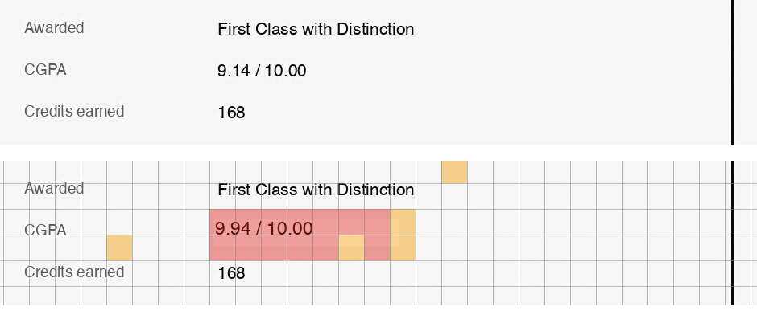
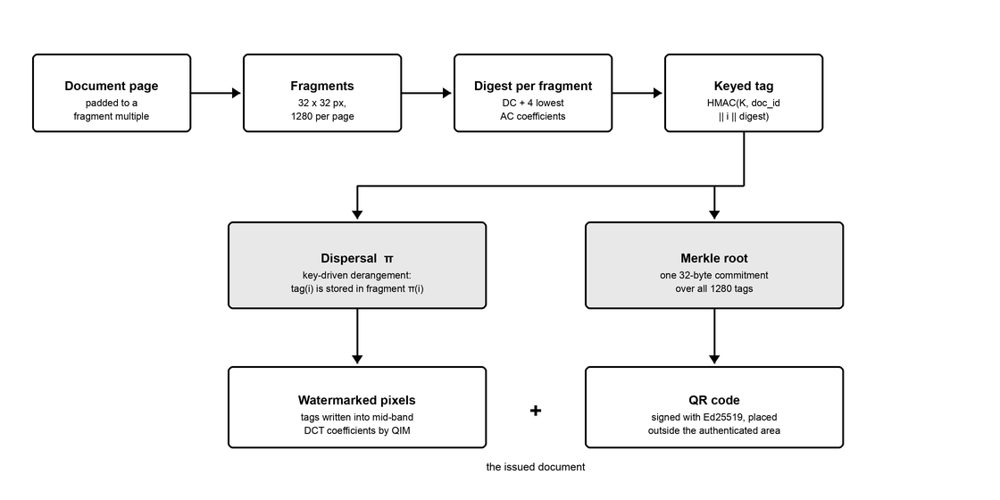
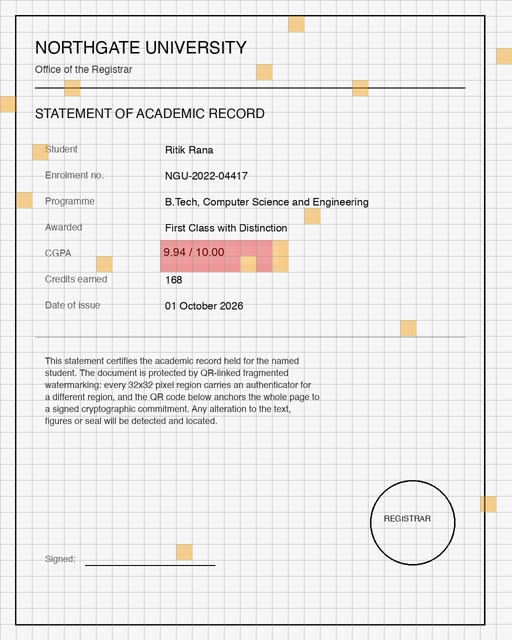

<h1 align="center">QLFW</h1>
<p align="center">
  <strong>QR-Linked Fragmented Watermarking for Tamper-Evident Document Authentication</strong><br>
  <sub>Detect that a document was altered — and show exactly <em>where</em>.</sub>
</p>

---

## The problem

Take a marksheet. Anyone can open it in an image editor, change the CGPA from
9.14 to 9.94, and save. It looks perfect. Nobody can tell.

Why not just sign the file? Two reasons:

- A signature says only **"this file changed"** — never *which part* changed.
- A signature **dies** the moment the document is printed, scanned, screenshotted
  or re-saved. The marks are still readable; the proof is gone.

QLFW hides the proof **inside the pixels**, so it travels with what you can see.

<p align="center">
  <br>
  <sub>Top: the protected certificate. Bottom: after someone edited the CGPA.
  Red is the located edit.</sub>
</p>

---

## The idea in one paragraph

Cut the page into 1,280 small squares. For each square, write a secret receipt
describing what it looks like. Now the trick: **don't keep a square's receipt in
that square — hide it in a different one**, picked by a secret key. A forger who
edits a square can't repair the receipt, because it isn't there and they don't
know where it went. Finally, print a QR code holding a signed summary of all
1,280 receipts, so nobody can wipe the watermark and redo the page with their own
key.

---

## Quick start

```bash
git clone https://github.com/ritik-roushan-rana/FragmentSeal.git
cd FragmentSeal
python3 -m venv .venv && .venv/bin/pip install -r requirements.txt
```

### Option 1 — the website (easiest)

```bash
./web.sh
```

Opens `http://127.0.0.1:5005`. Three steps: **Protect** a document → **Forge** it
→ **Verify** it. The verdict shows as a green or red badge with the tamper map
drawn underneath.

The forgery is not rigged. Either the computer picks the region at random, or you
click the spot on the image and it forges exactly there. Verification only ever
receives the file and the key.

### Option 2 — the terminal

```bash
./demo.sh
```

Runs the whole story end to end: issue a key, watermark, verify (clean), forge,
verify (caught). `./present.sh` is the same thing but pauses between steps, and
accepts your own file: `./present.sh ~/my-certificate.pdf`

### Option 3 — command by command

```bash
# 1. Create an issuer key (HMAC key + Ed25519 pair, saved with mode 0600)
.venv/bin/python -m qlfw keygen --out out/issuer.key

# 2. Watermark a document
.venv/bin/python -m qlfw embed samples/certificate.png out/signed.png --keyfile out/issuer.key

# 3. Verify it — prints AUTHENTIC, exits 0
.venv/bin/python -m qlfw verify out/signed.png --keyfile out/issuer.key

# 4. Forge it at a spot chosen at random
.venv/bin/python -m qlfw tamper out/signed.png out/forged.png --mode text --rect random --text "VOID"

# 5. Catch it — prints TAMPERED and writes a tamper map
.venv/bin/python -m qlfw verify out/forged.png --keyfile out/issuer.key --map out/map.png
```

`verify` exits 0 only for an authentic document, so it drops straight into a
script. Add `--json` for a machine-readable report naming the altered fragments.

---

## How it works

<p align="center"></p>

### Issuing a document

| # | Step | What happens |
|---|------|--------------|
| 1 | **Partition** | The page is padded and split into 32×32 px fragments. A 1024×1280 page gives 1,280 of them. |
| 2 | **Digest** | Each fragment is reduced to a hash of its coarse appearance — the DC and four lowest AC coefficients of its DCT. |
| 3 | **Tag** | `tag(i) = HMAC(key, doc_id ‖ i ‖ digest(i))`, truncated to 64 bits. |
| 4 | **Disperse** | A key-driven derangement π sends tag *i* into fragment **π(i)** — never its own. |
| 5 | **Embed** | Tags are written into mid-band DCT coefficients by quantisation index modulation. Invisible. |
| 6 | **Anchor** | A Merkle root over all 1,280 tags is signed with Ed25519 and printed as a QR code below the page. |

### Verifying a document

The verifier gets **only the file and the key**. It is never told what changed,
where, or whether anything did.

1. Read the QR → parameters, Merkle root, signature.
2. Recompute every fragment's digest **from the pixels as they are now**.
3. Recompute what each tag *should* be.
4. Extract the tag actually hidden in the pixels — for fragment *i*, look inside π(i).
5. Compare. A mismatch means **that fragment was altered**, reported by row and column.

### Why each piece is there

**Why disperse the tags?** If a tag lived in its own fragment, every fragment
would be a self-contained valid unit and the document just a bag of
interchangeable parts. Dispersal interlocks it: repairing fragment *i* breaks
π(i), whose tag lives in π(π(i)), and so on. A local edit cascades into a
document-wide inconsistency nobody can resolve without the key.

**Why bind the tag to the index?** So that genuine content copied from elsewhere
on the same page carries a tag computed for the wrong position, and is rejected.

**Why a QR as well?** Someone could strip the watermark and re-watermark the page
with *their* key — every fragment would then be internally consistent. The signed
Merkle root pins the page to one exact set of tags and one issuer. The watermark
proves integrity; the QR proves **origin**.

**Why doesn't embedding break the digests?** A fragment's digest depends on its
pixels, but those pixels also carry someone else's tag. The two are kept in
disjoint sets of DCT coefficients — digests read only the lowest, payloads only
the mid-band — so writing a tag can never disturb a digest.

---

## Architecture

| Module | Responsibility |
|---|---|
| `qlfw/transform.py` | Vectorised 8×8 DCT and fragment tiling |
| `qlfw/carriers.py` | DCT-QIM and LSB carriers; the digest ⁄ payload coefficient split |
| `qlfw/crypto.py` | HMAC tags, the dispersal derangement, Merkle root, Ed25519 |
| `qlfw/manifest.py` | The packed binary QR record and the self-validating renderer |
| `qlfw/pipeline.py` | `embed()` as a fixed-point search; `verify()` with localisation |
| `qlfw/docio.py` · `pdfwrite.py` | Image and PDF input, lossless PDF output, QR attachment |
| `qlfw/report.py` | Tamper-map overlay and console output |
| `qlfw/tamper.py` | Attack simulation, for demos and tests |
| `qlfw/cli.py` | The command line |
| `webapp/` | Flask demo site — a thin shell over the same library, no crypto of its own |

---

## Carriers

| | `dct` (default) | `lsb` |
|---|---|---|
| Domain | Mid-band DCT, QIM | Bit 0 of the last channel |
| Fragility | Semi-fragile | Fragile |
| Survives | JPEG to q92; noise to σ≈1 | Nothing; any re-encode fails |
| Colour | Converts to grayscale | Authenticates all channels |
| PSNR | ≈29 dB | ≈63 dB |
| Use for | Scanned or re-encoded documents | Born-digital documents |

---

## Verdicts

| Verdict | Meaning |
|---|---|
| `AUTHENTIC` | Root matches, every fragment checks out, signature from the expected issuer. |
| `TAMPERED` | Some fragments failed. The map says which. |
| `UNTRUSTED_ANCHOR` | The anchor isn't signed by the expected issuer — a forged QR, or the wrong key file. The report says which is likelier. |
| `WRONG_KEY_OR_REPLACED` | Every fragment failed — wrong key, or a different document. |
| `UNVERIFIABLE` | Geometry no longer matches; fragment alignment is lost. |

`signature_ok` is three-valued. `None` means the question was never asked —
unsigned document, or no issuer key supplied — and is never reported as a pass.

---

## What was measured

<p align="center">
  <br>
  <sub>A full tamper map. Red is the located edit. The scattered amber fragments
  are those whose tags were hidden inside the edited region — the dispersal
  showing its work.</sub>
</p>

**Localisation**, over 400 trials with independently generated keys:

| Carrier | Trials | Edit missed | Mean false positives | Max |
|---|---|---|---|---|
| DCT | 200 | 0 | 0.20 | 2 |
| LSB | 200 | 0 | 0.14 | 2 |

Recall is complete — the edit was never missed. False positives come from the
dispersal itself: when an edited fragment's guardian was *also* inside the edit,
a third fragment gets promoted.

**Robustness** of the DCT carrier:

| Attack | Strength 8 (default) | Strength 16 |
|---|---|---|
| JPEG q92 | clean | clean |
| JPEG q90 | 2 of 1280 flagged | clean |
| JPEG q85 | total failure | — |
| Noise σ=1.0 | 2 of 1280 flagged | 3 of 1280 flagged |
| Noise σ=2.0 | total failure | 146 of 1280 flagged |
| PSNR | 29.26 dB | 23.66 dB |

---

## Three problems worth knowing about

**The scheme has to close on itself.** A fragment's tag depends on its content,
but that content is where another fragment's tag is written. Beyond the
coefficient split, `embed` iterates to a genuine fixed point — reading digests
back from the *rendered* image — so the document that ships is one verified
against itself, not assumed consistent. If it can't converge in eight rounds it
refuses to write a file. In practice it converges in two.

**A document page is almost all saturated white.** A saturated block has no room
to be modulated: the clip back to 8-bit erases the payload. The first working
version lost 11% of its payload bits this way. Compressing the tonal range by one
quantisation step at each end buys the headroom back — and costs the DCT carrier
most of its PSNR, since the background sits a shade off pure white.

**Two output paths silently destroyed the watermark.** Pillow JPEG-encodes PDF
pages, so `pdfwrite.py` writes FlateDecode streams instead. And PDF rasterisation
returns a page one pixel off at any density where the page box is a fractional
number of points, so rendering is restricted to 72·2^k DPI, where the round trip
is bit-exact.

---

## Limits

- **Verification needs the secret key.** The Ed25519 signature gives public
  attribution of the anchor; authenticating the pixels needs the HMAC key.
- **Narrow robustness envelope.** Clean through JPEG q92 and noise σ≈1 at default
  settings. Past that it fails loudly rather than producing a plausible-looking
  partial tamper map.
- **Geometric attacks are out of scope.** Rotation, cropping and rescaling destroy
  fragment alignment; these report `UNVERIFIABLE`, not `AUTHENTIC`.
- **Print-and-scan is not supported.** Mild recompression, yes; a full analogue
  round trip, no.
- **Localisation is not exact.** Recall is complete, precision is bounded — up to
  two false positives observed.
- **Chroma is unprotected under the DCT carrier**, which converts to grayscale so
  every authenticated byte lies in the plane it controls. The LSB carrier covers
  all channels.

---

## Tests

```bash
.venv/bin/python -m pytest tests -v
```

61 tests across the cryptographic primitives, the QR wire format, both carriers,
the PDF round-trip and the CLI. Several encode claims this README makes —
including the JPEG breakdown point, the bit-exactness of the PDF raster
round-trip and the bound on false positives — because a regression in any of
those would produce incorrect verdicts silently rather than failing visibly.

---

## Project layout

```
qlfw/            the library and CLI
webapp/          Flask demo site (app.py + static/index.html)
tests/           61 tests
doc/             project report (.docx), its build script and figures
samples/         a generated sample certificate
demo.sh          scripted end-to-end walkthrough
present.sh       the same, paused between steps, accepts your own file
web.sh           starts the demo website
```

A full write-up is in [`doc/QLFW_Project_Report.docx`](doc/QLFW_Project_Report.docx).
